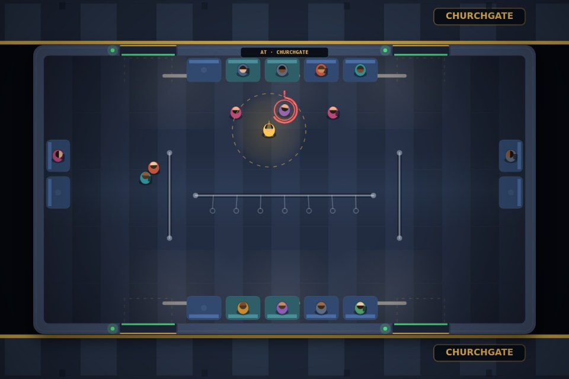

# Train Guard — Western Line

A tiny, dependency-free browser game: **you are the guard on the last coach**.
Work the doors, keep the platform moving on time, and steady the passengers who
lose their footing whenever the track kicks.

No build step, no frameworks, no bundler. Three files and a static server.

```bash
npm start      # http://localhost:5173
npm test       # 28 tests: balance model, scoring, DOM wiring, headless play-through
```



## Controls

| Input | Action |
| --- | --- |
| `W A S D` / arrows | walk the coach |
| `Q` / `E` | north / south doors |
| `Space` (hold) | steady everyone within reach |
| `P` / `Esc` | pause |
| `M` | mute |
| drag on the coach | walk towards the pointer (touch friendly) |
| the on-screen door buttons | same as `Q` / `E`, for phones |

Hold **STEADY / Space** while standing near a passenger to keep them upright.
You can't hold it and hustle at the same time — you walk at a third of the speed.

## The loop

Every stop runs on a dwell timer:

1. **Doors open** → the platform queue walks in and finds a seat or a grab pole.
2. **Doors close** → with nobody left waiting, the train departs and you bank
   points for the exchange plus a punctuality bonus.
3. **Cruise** → the coach sways and the track throws jolts. Standing passengers
   who get a bad enough jolt go into a **stumble**: a ring drains for ~1.3s and
   then they hit the floor. Reach them and hold steady to cancel it.
4. **Brake** → passengers whose stop is next stand up and head for a door
   *while the train is still moving*. That's where the hard jolts hurt.

A fall costs a safety rating (5 per shift) and −40 points. Miss the dwell timer
and the doors force-close: anyone still on the platform is left behind, which
kills the punctuality bonus for that stop.

## Scoring

| Event | Points |
| --- | --- |
| Passenger boarded / alighted | +8 each |
| Beating the dwell timer with nobody stranded | up to +60 |
| Steadying a stumbling passenger | +5 |
| Passenger left on the platform | −10 |
| Passenger falls | −40 |
| Doors close on somebody | −15 |

Four consecutive stops without a fall restores one safety rating.

## How it's put together

```
game.js        pure simulation (top) + canvas renderer and DOM wiring (bottom)
index.html     HUD, overlays, canvases
style.css      the shell: HUD, overlays, mobile rules
server.mjs     ~40 line static file server, no dependencies
test/          logic tests + a DOM-stub harness that boots the real game
```

Below a legible zoom level the camera zooms in and follows the guard, so a
phone in portrait still shows a readable coach instead of a postage stamp.

`game.js` exports the parts worth testing (`createRider`, `applyJolt`,
`resolveJolt`, `stepBalance`, `scoreStop`, `difficultyFor`, `tripChance`) and
only touches the DOM behind a `typeof document !== 'undefined'` guard, so the
same file runs in the browser and under `node --test`.

### The balance model

Falling is **not** random per frame. A jolt gives every exposed rider a
`risk = strength × carriageForce × grip`; the trip chance is a bounded ramp of
that risk (`tripChance`), and at most `BALANCE.tripsPerJolt` riders go down on
any one bump — the least steady ones first. That keeps a single jolt from
wiping the coach, and it means the difficulty curve is a *frequency* curve:
early stops rarely trip anyone, later stops trip two or three at a time.

A stumble is a countdown, not a physics accident, so the guard always gets a
fair, visible reaction window. Holding steady burns the countdown at 3× and
cancels the fall. The numbers were tuned with a Monte-Carlo sweep of the cruise
simulation (jolt timing × difficulty × grip) rather than by eyeballing it.

## What was deliberately left out

- No framework, no bundler, no `node_modules` — the whole game is ~1.4k lines.
- No server-side auth, sessions, cookies or rate limiting: this is a static
  game with a local high score in `localStorage`. Adding a scrypt/opaque-session
  stack here would be pure cost — those belong in the backend that would own
  leaderboards, and the game doesn't have one.
- No sprite sheets or image assets: every rider, door and light is drawn with
  canvas primitives, so the repo stays text and tiny.
- No analytics, no telemetry, no external requests at runtime.
