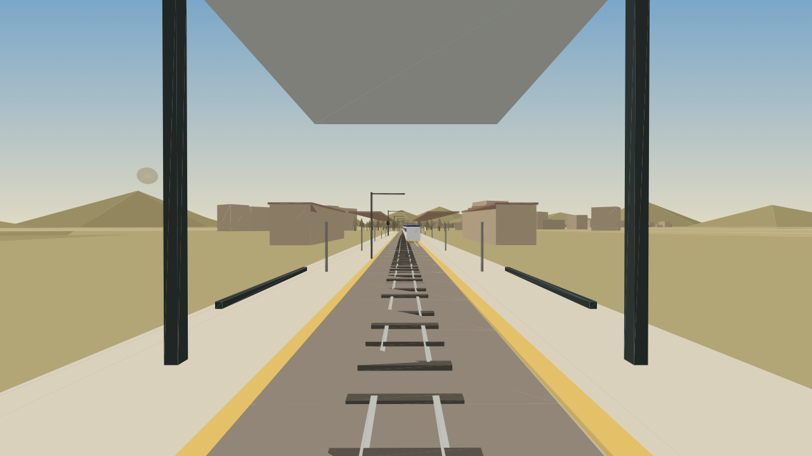
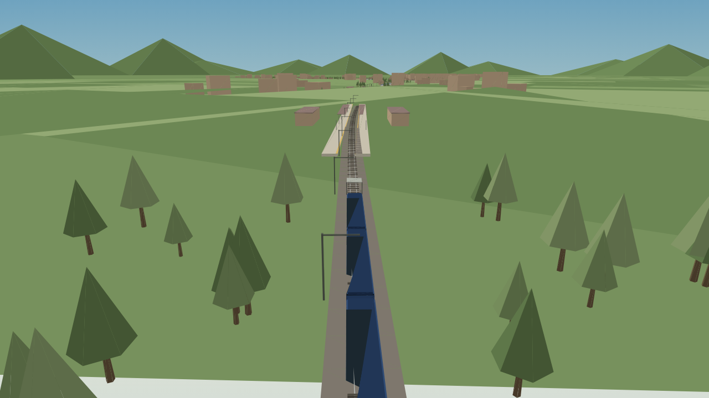
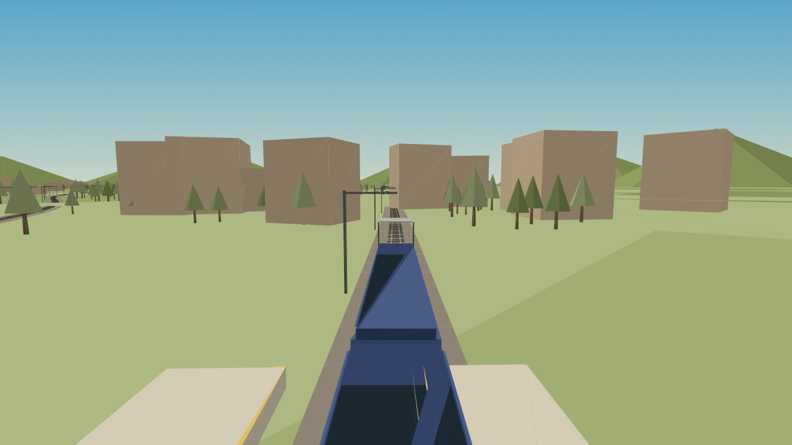

# Train Driver — Indian Locals

A browser driving sim: you sit in the cab of a real 3D railway, on four
different networks in four different cities, running locals and
long-distance expresses to a timetable.

No build step and no CDN. three.js is vendored in `vendor/`, so the game runs
from any static server, offline.

```bash
npm start     # http://localhost:5173
npm test      # 44 node tests: cities, sim, 3D scene, headless app boot
python3 -m unittest discover -s test   # 27 tests for auth.py
```

| | |
| --- | --- |
|  |  |
| *Mumbai — Western Line, from the cab* | *Delhi — Ring Railway on approach* |
|  |  |
| *Kolkata — lineside camera* | *Chennai — chase camera* |

## Four cities, four locals

Choose on the title card — click a row or press `1`–`4`. Each city builds its
own railway from its own seed, and runs its own rolling stock.

| City | Line | Locals | Long-distance | Livery |
| --- | --- | --- | --- | --- |
| Mumbai | Western Line | 12-car EMU | 18-coach Saurashtra Express | maroon, blue doors |
| Delhi | Ring Railway | 8-car EMU | 20-coach Rajdhani Express | blue, yellow band |
| Kolkata | Circular Railway | 9-car EMU | 17-coach Duronto Express | deep blue, cream |
| Chennai | South Line | 9-car EMU | 19-coach Coromandel Express | green, yellow ends |

**Locals** are electric multiple units: cab end, rows of sliding doors, window
band, curved roof. **Long-distance services are locomotive-hauled** — a painted
locomotive with a nose, lamps and a pantograph, then 17–20 coaches with end
walls, vestibules, roof ribs and bogies. The express is always far longer than
the local on the same line, and it is the train you start in.

Every network has a trunk line and a branch that leaves it at a junction, with
six trains working it: the express you drive, a superfast, three locals and a
branch shuttle.


## The view

Three cameras, cycled with **C** (or drag the scene to swing the lineside
camera around):

* **cab** — first person, at the head of the train, with the windscreen frame,
  A-pillars and headlining drawn in 3D around you;
* **chase** — just above the roof, looking down the train;
* **lineside** — orbit the train from the lineside and watch it go past.

The HUD carries the analogue speedo, the power and brake levers, lamp
repeaters (doors, signal, limit, horn), the next stop with distance and the
three after it, plus the clock and the score.

## Controls

| Input | Action |
| --- | --- |
| `W` / `↑` | power |
| `S` / `↓` | brake |
| `Space` | emergency brake |
| `D` | doors, at a platform |
| `H` | horn (two-tone, synthesised) |
| `C` | cycle camera |
| `Tab` | take the next train (the cab comes with you) |
| `T` | hand over to the autopilot |
| `P` / `Esc` | pause |
| `1` `2` `3` | jump straight to cab / chase / lineside |

## How it works

* `src/cities.js` — the four cities: stations, liveries, palettes, seeds.
* `src/world.js` — grows a network from a city seed: trunk, branch, station
  records, signals, and a fleet with routes resolved in the direction of travel.
* `src/sim.js` — metres per second throughout; braking-curve AI that stops at
  the board, block signals that consider only the asking direction, doors that
  only release at a platform, and traffic that holds its distance instead of
  rear-ending itself.
* `src/scene3d.js` — the 3D world: ballast, rails, instanced sleepers, catenary
  masts and wire, platforms with canopy and name boards, station buildings,
  lineside trees and town blocks, signal lamps, rolling stock and the cab.
* `src/app.js` — boot, cities, input, cameras, HUD, horn, pause.

Rendering is plain three.js WebGL. The tests boot the real app headlessly with
a renderer stub, and the scene tests count meshes and triangles in every city
so an empty world cannot pass.

## auth.py

The lean password/session module, kept from the earlier review work: PBKDF2 with
a per-user salt, constant-time comparison, a decoy hash so unknown usernames cost
the same as known ones, bounded lockout counters and opaque expiring sessions.
27 `unittest` cases, including timing and lockout-expiry behaviour.
