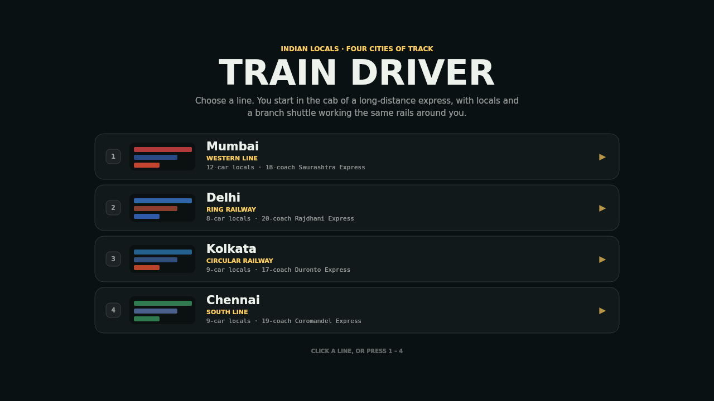
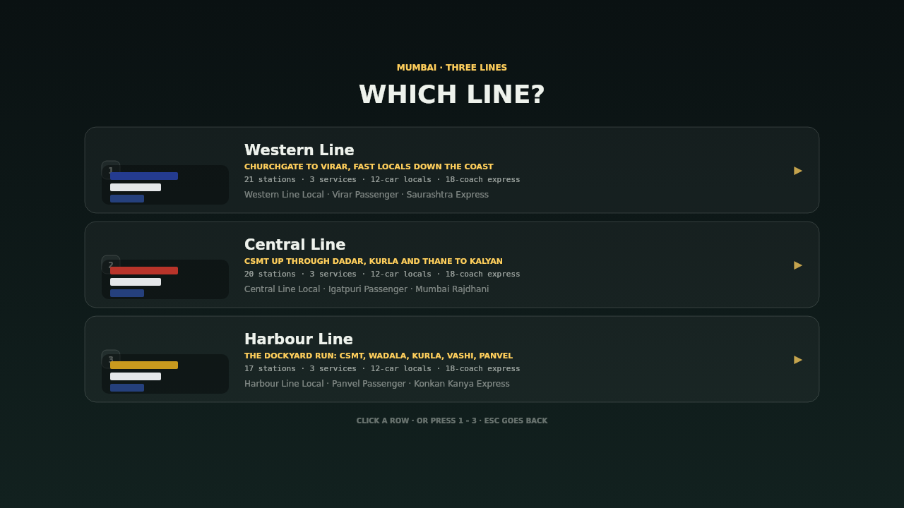
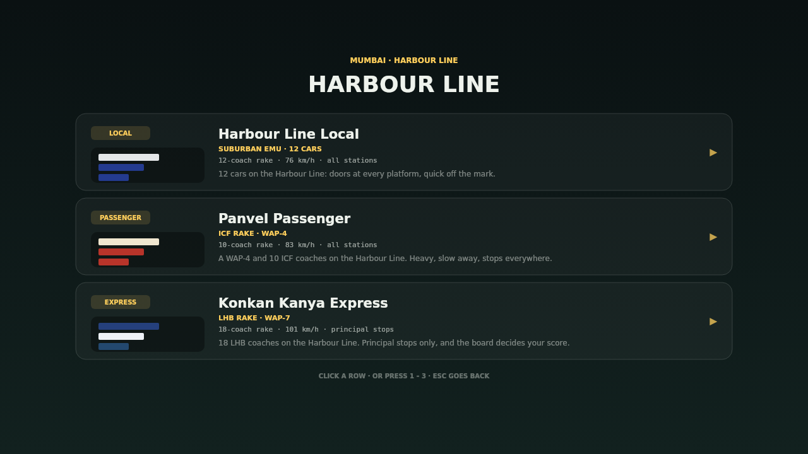
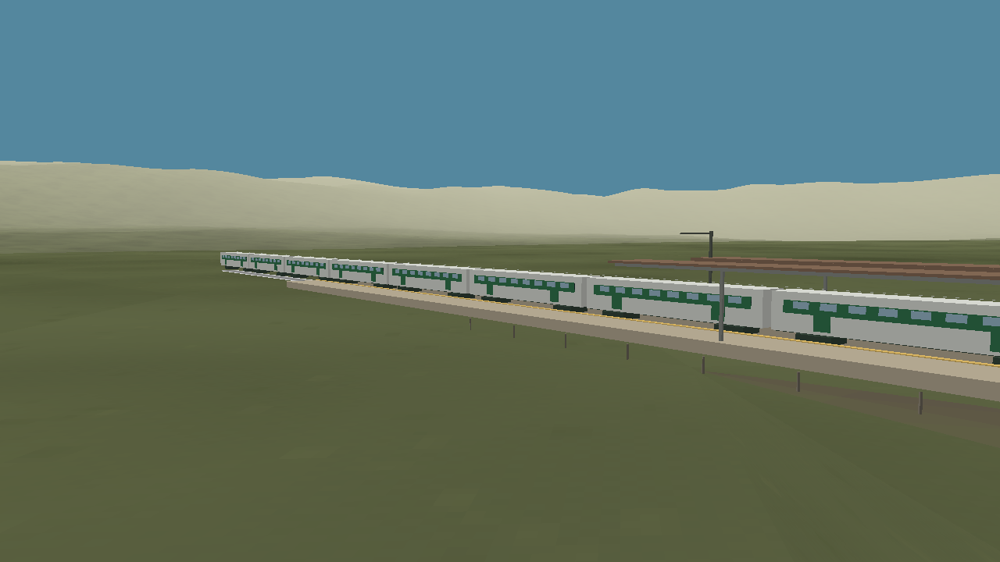
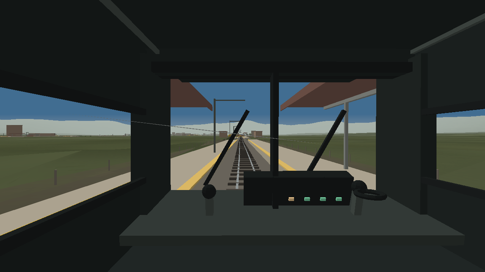
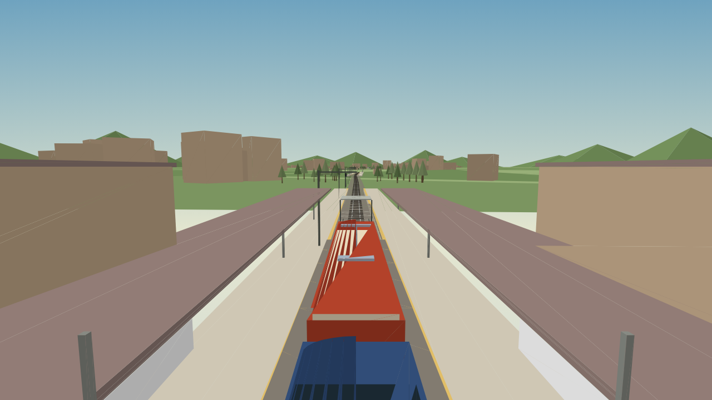
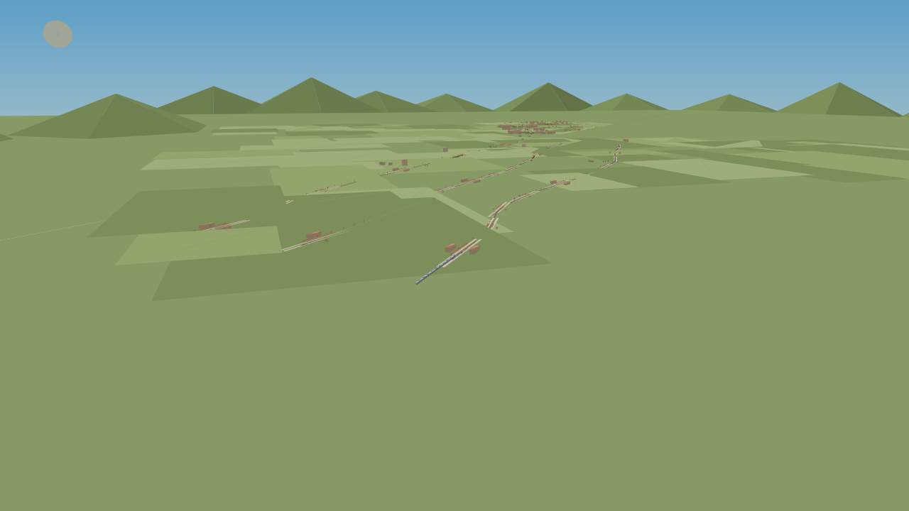

# Train Driver — Indian Locals

A browser driving sim: you sit in the cab of a real 3D railway, on four
different networks in four different cities, running suburban locals, loco-
hauled passengers and long-distance expresses to a timetable.

No build step and no CDN. three.js is vendored in `vendor/`, so the game runs
from any static server, offline.

```bash
npm start     # http://localhost:5173
npm test      # 49 node tests: cities, sim, 3D scene, headless app boot
python3 -m unittest discover -s test   # 27 tests for auth.py
```

| | |
| --- | --- |
|  |  |
| *Pick a city* | *Then the line you want to work* |
|  |  |
| *Then the trains on that line* | *Chennai — a nine-car local at a halt* |
|  |  |
| *Mumbai — Western Line, from the cab* | *Kolkata — chase camera off the shoulder* |
|  | |
| *Mumbai — Western, Central and Harbour in one corridor* | |

## Four cities, three real lines each — 35 services

Choose a city (`1`–`4`), then the **line** you want to work, then the **train**
on that line. Every line keeps its own roster: Mumbai's Western runs a 12-car
local, a Virar passenger and the Saurashtra Express; its Harbour runs a local,
the Panvel passenger and the Konkan Kanya. You never pick a train that doesn't
belong to the line you're about to drive.

| City | Line | Local | Passenger | Express |
| --- | --- | --- | --- | --- |
| **Mumbai** | Western | Western Line Local, 12-car EMU | Virar Passenger (ICF · WAP-4) | Saurashtra Express (18 LHB · WAP-7) |
| | Central | Central Line Local, 12-car EMU | Igatpuri Passenger (ICF · WAP-4) | Mumbai Rajdhani (18 LHB · WAP-7) |
| | Harbour | Harbour Line Local, 12-car EMU | Panvel Passenger (ICF · WAP-4) | Konkan Kanya Express (18 LHB · WAP-7) |
| **Delhi** | Ring | Ring Railway Local, 8-car EMU | Sarai Rohilla Passenger (ICF · WAP-4) | Sarai Rohilla Duronto (20 LHB · WAP-5) |
| | Gurgaon | Gurgaon Road Local, 8-car EMU | Rewari Passenger (ICF · WAP-4) | Mewar Express (20 LHB · WAP-5) |
| | Ghaziabad | Ghaziabad Local, 8-car EMU | Meerut Passenger (ICF · WAP-4) | Vaishali Express (20 LHB · WAP-5) |
| **Kolkata** | Circular | Circular Railway Local, 9-car EMU | Majerhat Passenger (ICF · WAP-4) | Haldia Duronto (17 LHB · WAP-7) |
| | Sealdah South | Sealdah South Local, 9-car EMU | Baruipur Passenger (ICF · WAP-4) | Sundarban Express (17 LHB · WAP-7) |
| | Howrah Main | Howrah Local, 9-car EMU | Bandel Passenger (ICF · WAP-4) | Howrah Duronto (17 LHB · WAP-7) |
| **Chennai** | South | Beach–Tambaram Local, 9-car EMU | Chengalpattu Passenger (ICF · WAP-4) | Pallavan Express (19 LHB · WAP-7) |
| | North | North Line Local, 9-car EMU | Arakkonam Passenger (ICF · WAP-4) | Coromandel Express (19 LHB · WAP-7) |
| | MRTS | MRTS Local · MRTS Fast Local (EMU only) | — | — |

**Three different machines, not three liveries.** A local is an EMU: flat cab
end, four doors a side, white body with the city's band, quick away and 20–21
m/s flat out. A passenger is a WAP-4 and ten cream ICF coaches: ribbed sides,
slow off the mark, stops at every station. An express is a WAP-7 (a WAP-5 in
Delhi) and 17–20 LHB coaches: sealed navy or maroon stock, 28–29 m/s, principal
stops only. The MRTS is an EMU-only corridor, so its line offers a stopping
local and a fast one instead of stock it never carries.

Every network carries seven trains — yours, a superfast coming the other way,
a local ahead of you, and a local plus a passenger on each of the other two
lines — all held apart by block signals and a braking curve.

The stations are real: Churchgate, Mumbai Central, Dadar, Kurla, Thane, Kalyan;
Nizamuddin, Safdarjung, Gurgaon, Ghaziabad; Dum Dum, Bara Bazar, Eden Gardens,
Majerhat, Sealdah, Howrah, Bandel; Beach, Egmore, Guindy, Tambaram, Avadi,
Velachery. 58 stations in Mumbai alone, each with two platforms, a name board
in the line's colour, and a canopy or a halt shelter depending on its size.

## The view

Three cameras, cycled with **C** (drag the scene to swing the lineside camera):

* **cab** — first person in a built cab: windscreen frame, pillars, dash,
  traction and brake handles, headlining, and a bonnet you can see over;
* **chase** — a drone off the loco's shoulder, high enough to clear the coach
  roofs and pitched down the line so you can still drive on it;
* **lineside** — stand off the track and watch the whole 200–400 m rake go by.

The HUD carries the analogue speedo, the power and brake notch levers, lamp
repeaters (doors, signal, limit, horn), the next stop with distance and the
green-zone chip, the score and the run's message log — and a **line map**: every
station on the line you are working, the majors named, the next stop ringed,
your train moving along it and the traffic on the same line moving with you.

## Controls

| Input | Action |
| --- | --- |
| `W` / `↑` | power notch up (8 notches) |
| `S` / `↓` | brake notch up (8 notches) |
| `X` | release both levers |
| `Space` | emergency brake |
| `D` | doors, at a platform |
| `H` | horn (two-tone, synthesised) |
| `C` | cycle camera |
| `Tab` | take the next train (the cab comes with you) |
| `T` | hand over to the autopilot |
| `P` / `Esc` | pause |
| `1` `2` `3` | jump straight to cab / chase / lineside |

At the title card, `1`–`4` pick a city; inside the Drive menu, `1`–`3` pick a
line, then `1`–`3` pick a train. `Esc` walks back up the menu.

## How it works

* `src/cities.js` — the four cities: three lines each with their stations,
  palettes, seeds, and the three rakes (EMU / ICF / LHB) a city owns.
* `src/world.js` — grows the network from a city seed: one base alignment, then
  each line offset into its own corridor, station records per line, signals,
  and a fleet with routes resolved in the direction of travel.
* `src/sim.js` — metres per second throughout; notched driving, braking-curve
  AI that stops at the board, block signals that consider only the asking
  direction, doors that release only at a platform, green-zone scoring with
  penalties and bonuses, and traffic that holds its distance.
* `src/scene3d.js` — the 3D world: ballast, rails, instanced sleepers, catenary
  masts and wire, platforms with canopy and name boards tinted to the line,
  station buildings (only at major stations), lineside trees and town blocks,
  signal lamps, instanced rolling stock, and the cab interior.
* `src/app.js` — boot, city and Drive menus, input, cameras, HUD, horn, pause,
  run summary.

Rendering is plain three.js WebGL, one draw call per coach part thanks to
instancing. The tests boot the real app headlessly with a renderer stub and the
scene tests count meshes and triangles in every city, so an empty world cannot
pass. Booting a second app detaches the first one's listeners, so the menu
stays driveable when the page is re-booted.

## auth.py

The lean password/session module, kept from the earlier review work: PBKDF2 with
a per-user salt, constant-time comparison, a decoy hash so unknown usernames cost
the same as known ones, bounded lockout counters and opaque expiring sessions.
27 `unittest` cases, including timing and lockout-expiry behaviour.
